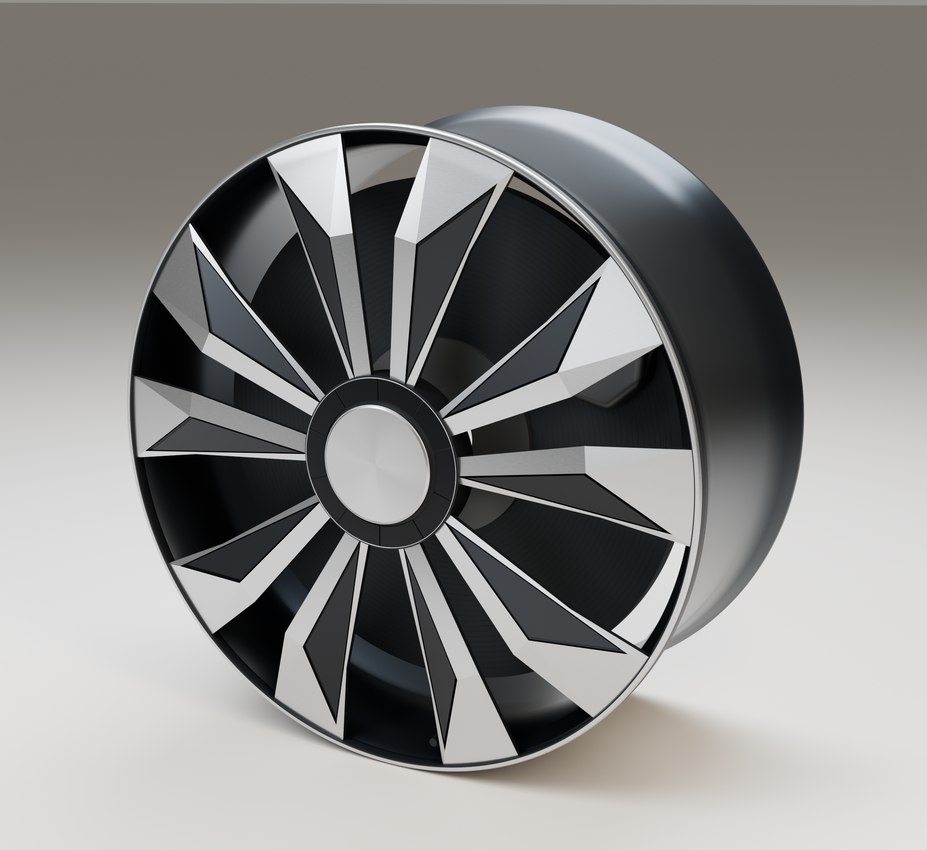
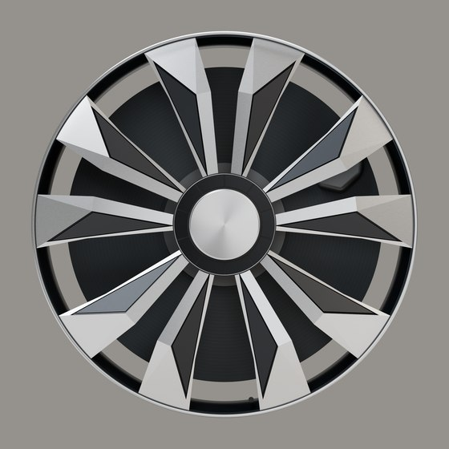
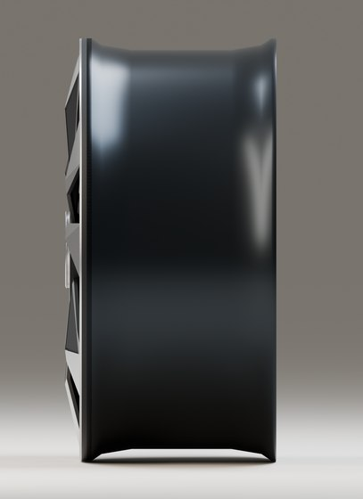
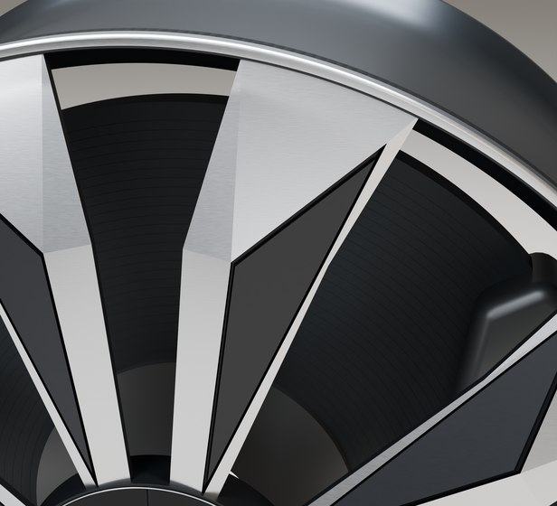
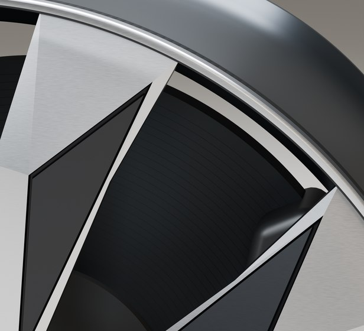
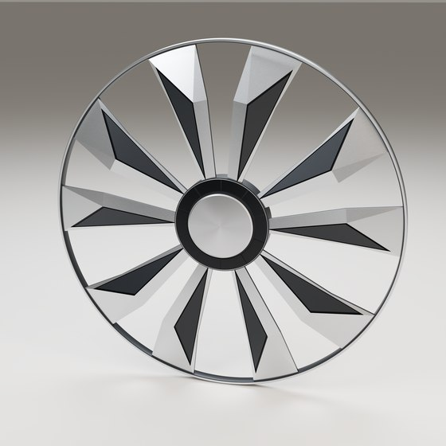

# 造物台 · AI 工业设计工作台

造物台把参考图、设计方案、几何模型和渲染结果放在同一个浏览器项目中。设计师可以逐阶段调用自己的模型，修改生成的方案或脚本，再将成果传给下一阶段。仓库附带一个完整的轮毂盖案例，可直接查看图像或下载工程研究。

[在线工作台](https://zaowutai-wheel-studio.goldendace4.chatgpt.site/) · [设计参考板](dist/参考板.jpg) · [下载 Blender 工程](dist/assets/新参考图_银色包边石墨内凹_轮毂盖.blend)

## 银边石墨轮毂盖 · 渲染图集

[](dist/assets/02_参考款_四分之三视图.png)

**四分之三主视图。** 五组分叉辐条从中心展开。每片辐条的银色切削面在外缘变宽，与内凹的石墨色三角面形成明暗分界。点击任一预览可查看对应的原尺寸 PNG。

| 正视轮廓 | 轮辋侧视 |
| --- | --- |
| [](dist/assets/01_参考款_正视形状.png) | [](dist/assets/03_参考款_轮辋侧视.png) |
| 观察五组辐条的开口、镜像关系和圆周排列。 | 观察盖面相对轮辋的突出量及轮辋纵深。 |

| 中心盖与分段圈 | 银色包边与石墨内面 |
| --- | --- |
| [](dist/assets/04_中心旋纹盖与分段圈.png) | [](dist/assets/05_银色包边与内凹石墨面.png) |
| 中心盖的旋纹高光与周围分段装饰圈。 | 银色折面由宽肩收成窄边，围住低光泽石墨面。 |

| 黑色凹槽与金属交界 | 独立轮毂盖 |
| --- | --- |
| [](dist/assets/06_黑色凹槽与金属交界.png) | [](dist/assets/07_轮毂盖独立产品图.png) |
| 近看槽壁阴影、金属倒角和高光转折。 | 单独展示盖体，便于检查中心与外缘的收口。 |

## 工作流程与交付物

| 阶段 | 主要工作 | 可保存的成果 |
| --- | --- | --- |
| 设计灵感 | 整理参考图，记录造型特征、尺寸假设与验收要点 | Markdown 设计方案 |
| 工业设计图 | 将方案转成正视、侧视等概念线图 | PNG 图纸及对应的 JSON 线段数据 |
| Blender 建模 | 根据上游方案和图纸生成几何结构 | 可编辑的 Blender Python 脚本 |
| 材质与灯光 | 为已有模型配置材质节点、表面纹理和棚拍灯光 | 材质与布光脚本 |
| 效果渲染 | 生成 Blender 相机与渲染脚本，或调用兼容的图像生成模型 | 渲染脚本或 AI 效果图 |

要检查设计还原度，可在「效果渲染」中选取正视图，点击「对照参考」并排检查轮廓，再切换到特写检查接缝。需要从其他角度观察几何时，下载本页的示例工程，用 Blender 5.2 打开。

## 本地运行

工作台是静态站点，使用 Python 3 即可在本机运行。在仓库根目录执行：

```sh
python -m http.server 8000 --bind 127.0.0.1 --directory dist
```

在浏览器访问 [本地工作台](http://127.0.0.1:8000/)。浏览示例和对照参考图无需 API Key。

## 模型接入与文件保存

1. 在所需阶段点击「生成」，选择模型服务，填写自己的 API Key。自定义服务需提供支持浏览器跨域访问的 HTTPS 接口。
2. 获取服务提供的模型列表或手动输入模型 ID。文本和脚本使用对话模型；附图分析需选择视觉模型；直接生成效果图需选择支持图像生成接口的模型。
3. 填写设计要求，确认是否附上阶段笔记、上游成果或当前图片，再执行生成。所选资料会随请求发送到所选服务。
4. 在阶段图库查看、下载成果。建模、材质和渲染脚本可在工作台中编辑，检查后按此顺序在本机 Blender 中执行。

API Key 仅用于当前页面会话。项目、上传文件及阶段笔记保存在当前浏览器的 IndexedDB 中。换设备、浏览器或站点地址时，可通过「项目迁移」导出备份，再在目标工作台导入。
